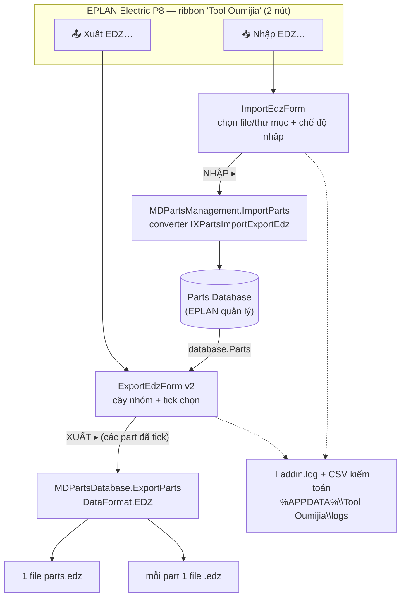
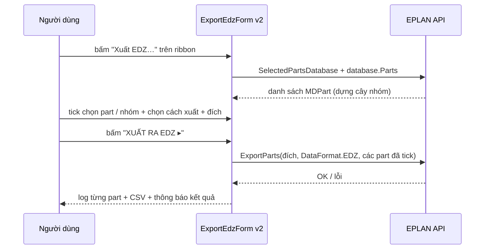

# Kế hoạch v0.3.0 — "Add-in duy nhất"

> ✅ **Đã triển khai đầy đủ trong v0.3.0 (2026-11-04)** — xem `CHANGELOG.md` mục `[0.3.0]`
> và `docs/releases/v0.3.0.md`. Tài liệu này giữ lại làm bản kế hoạch gốc (sơ đồ chức năng,
> thiết kế giao diện, tiêu chí nghiệm thu) để đối chiếu.
>
> *Theo yêu cầu người dùng: bỏ hẳn app exe, chỉ giữ add-in; làm lại dialog Xuất EDZ
> kiểu EPLAN — chọn part bằng cây nhóm như navigator.*

---

## 1. Mục tiêu & phạm vi

| # | Mục tiêu | Kết quả |
|---|---|---|
| M1 | Chỉ còn add-in — không còn app `.exe` | Ribbon "Tool Oumijia" 2 nút: **Nhập EDZ… / Xuất EDZ…**; repo tối giản |
| M2 | Dialog Xuất EDZ chọn được part | Cây nhóm (Record type → Nhóm → Hãng → Part) + tick chọn + tìm kiếm + đếm "Đã chọn: N" |
| M3 | Gói cài vẫn 1 click | `Tool-Oumijia-AddIn-v0.3.0.zip` (~100 KB): DLL + script đăng ký + installer + README |

**Ngoài phạm vi**: đổi cơ chế đăng ký (giữ nguyên đã kiểm chứng), nhúng vào Parts Management,
thay đổi dialog Nhập (giữ nguyên, chỉ bỏ nút mở app).

## 2. Sơ đồ chức năng



**Cơ chế nạp add-in** (không đổi, đã kiểm chứng — xem AGENTS.md mục 6):


## 3. Giao diện người dùng

### 3.1 Nhập EDZ… (giữ nguyên thiết kế, bỏ liên kết app exe)

```
┌─ Tool Oumijia — Nhập EDZ vào Parts Database ─────────────────────────────┐
│ Các gói EDZ cần nhập:                                                     │
│ [Thêm tệp…] [Thêm thư mục…] [Xóa mục chọn] [Xóa hết]                      │
│ Chế độ nhập: [Cập nhật + thêm mới ▾]  Nhận dạng: [Theo mã hàng ▾]         │
│                                                    [ ] Nhập thêm ngôn ngữ │
│ ┌────────────────────────────────────────────────────────────────────────┐│
│ │ D:\EDZ\Siemens_6ED1052.edz                                             ││
│ │ D:\EDZ\ABB_S201-C16.edz                                                ││
│ └────────────────────────────────────────────────────────────────────────┘│
│ [NHẬP VÀO PARTS DATABASE ▸]  Khuyến nghị: thử trên database test trước…   │
│ ┌ Nhật ký ──────────────────────────────────────────────────────────────┐ │
└───────────────────────────────────────────────────────────────────────────┘
```

### 3.2 Xuất EDZ… (THIẾT KẾ MỚI — trọng tâm v0.3.0)

```
┌─ Tool Oumijia — Xuất EDZ (chọn part cần xuất) ────────────────────────────┐
│ Database: ESS_part001 (đang mở)                                           │
│ [🔍 Tìm: ________________] [Chọn tất cả] [Bỏ chọn] [Lấy từ Parts Mgmt ▸]   │
│ ┌─ Cây part (như navigator EPLAN) ──────────────────────────────────────┐ │
│ │ ▣ Protection devices                                                  │ │
│ │   ☑ Safety switch                                                     │ │
│ │     ☑ SIE        └─ SIE.5SY61… · SIE.5SY62…                           │ │
│ │ ▣ PLC                                                                 │ │
│ │   ☐ General                                                           │ │
│ │     ☐ SIE        └─ SIE.6ED1052-1HB00-0BA6 (LOGO! 24RC)               │ │
│ └───────────────────────────────────────────────────────────────────────┘ │
│ Cách xuất:  (•) Một file EDZ:   [parts.edz____________] [Chọn…]           │
│             ( ) Mỗi part 1 file:[D:\Export\EDZ________] [Chọn…]           │
│ Đã chọn: 12 part                              [XUẤT RA EDZ ▸]             │
│ ┌ Nhật ký ──────────────────────────────────────────────────────────────┐ │
└───────────────────────────────────────────────────────────────────────────┘
   ☑ = đã tick   ☐ = chưa tick   ▣ = tick một phần (nhóm)
```

**Quy tắc tương tác:**

| Thao tác | Hành vi |
|---|---|
| Tick vào **nhóm** | Tick/bỏ tick toàn bộ part con (3 trạng thái, có "một phần") |
| Tick vào **part** | Cập nhật trạng thái các nhóm cha (checked/mixed) |
| **Tìm kiếm** | Lọc cây theo mã hàng / tên / hãng (không phân biệt hoa thường); chỉ hiện nhánh có kết quả |
| **Chọn tất cả** | Tick mọi part đang hiển thị (theo bộ lọc hiện tại) |
| **Bỏ chọn** | Bỏ tick tất cả |
| **Lấy từ Parts Management** | Đổ các part đang chọn sẵn trong cửa sổ Parts Management vào danh sách tick (không mất các tick khác) |
| Đếm "Đã chọn: N part" | Cập nhật mỗi lần tick/filter — luôn biết chính xác sẽ xuất gì |
| **XUẤT ▸** | Chặn nếu chưa chọn part hoặc chưa chọn đích; xác nhận → xuất → log từng part (CSV + addin.log) |

## 4. Thay đổi repo

### Xóa
```
src/Oumijia.Tool/          app WinForms (exe) + toàn bộ UI cũ
src/Oumijia.Core/          thư viện lõi của app
src/Oumijia.Register/      console thí nghiệm
tests/                     test suite của Core
examples/                  EDZ mẫu (của Core)
tools/make-samples.ps1
Tool-Oumijia-EPLAN.sln     (build add-in trực tiếp qua csproj)
.github/                   CI cũ (không build được add-in nếu không có EPLAN)
```

### Thêm
```
docs/PLAN-v0.3.0.md        tài liệu này
docs/releases/v0.3.0.md    (khi phát hành)
src/Oumijia.EplanAddIn/Ui/ExportEdzForm.cs   (viết lại toàn bộ)
src/Oumijia.EplanAddIn/Ui/PartsTreeModel.cs  (dựng cây nhóm + PartInfo)
src/Oumijia.EplanAddIn/Actions/DiagPartsAction.cs  (chẩn đoán headless)
tools/eplan-scripts/OumijiaRibbonDiag.cs     (đã có từ chẩn đoán — giữ)
```

### Sửa
```
src/Oumijia.EplanAddIn/AddIn.cs              bỏ nút "Cửa sổ Tool Oumijia"
src/Oumijia.EplanAddIn/ImportEdzForm.cs      gỡ văn bản liên quan app
tools/eplan-scripts/OumijiaRegister.cs       bỏ action OpenTool + TỰ DỌN key cũ
tools/pack.ps1                               gói zip add-in-only (phẳng, ~100 KB)
tools/install-addin/README.txt               cập nhật theo add-in-only
tools/release-extras/README.txt              cập nhật
README.md / AGENTS.md / CHANGELOG.md
docs/ (BUILD, INSTALL, USER-GUIDE, ARCHITECTURE, ROADMAP, RELEASING)
```

## 5. Luồng xử lý Xuất EDZ (tuần tự)



## 6. Tiêu chí nghiệm thu (UAT)

1. ✅ Cài 1 click, EPLAN hiện ribbon **2 nút**; không còn bất kỳ `.exe` nào trong gói.
2. ✅ Mở "Xuất EDZ…" khi Parts Management đang mở → **hiện cây part thật** kèm số lượng.
3. ✅ Tick 2–3 nhóm + vài part lẻ → "Đã chọn: N" đúng → xuất **1 file** và **mỗi part 1 file**.
4. ✅ Import lại file vừa xuất vào **database test** → part xuất hiện đúng.
5. ✅ Tìm kiếm "LOGO" chỉ hiện nhánh liên quan; "Lấy từ Parts Management" đồng bộ tick.
6. ✅ Headless: `OumijiaSelfTest` + `OumijiaDiagParts` pass (log sạch, không lỗi).
7. ✅ Không còn lỗi do key cũ `OumijiaOpenTool` (script đăng ký tự dọn).
