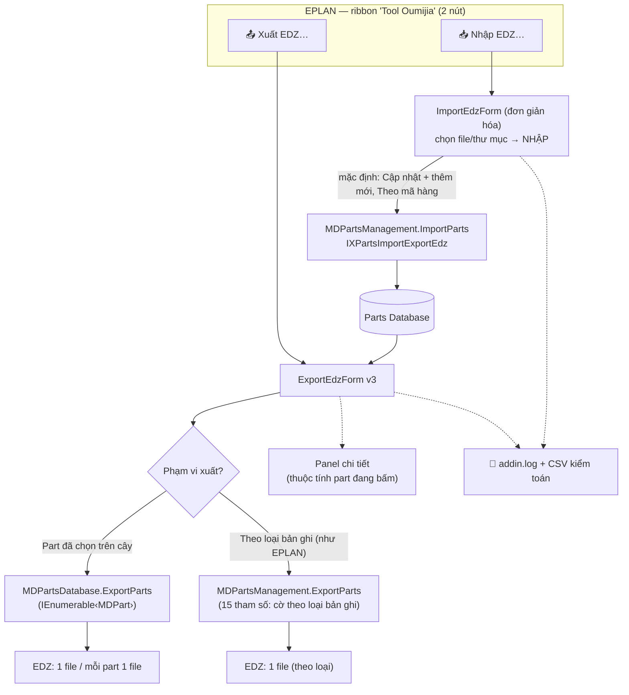

# Kế hoạch v0.4.0 — "Hoàn thiện theo UAT" (gộp toàn bộ yêu cầu)

> Trạng thái: **đang triển khai trong phiên này**. Tổng hợp từ phản hồi người dùng:
> - Fix lỗi tick không hiện dấu ✓ (dù đếm "Đã chọn" đúng)
> - Fix nút **XUẤT RA EDZ ▸** và **Chọn…** không hiển thị (layout neo phải bị đẩy khỏi vùng nhìn)
> - Thêm **panel mô tả** bên cạnh cây (như tab Overview của EPLAN) — bộ thuộc tính đầy đủ
> - Thêm **chế độ xuất theo loại bản ghi** (Parts / Accessory list / Accessory placement /
>   Drilling pattern / Connection point pattern / Customer / Manufacturer-supplier) — như EPLAN
> - **Bỏ hàng tùy chọn ở dialog Nhập** (Chế độ nhập / Nhận dạng part / Ngôn ngữ phụ) — nhập đơn giản
> - Kiểm thử kỹ hơn: smoke test API loại bản ghi + giải nén EDZ đối chiếu + construct UI offscreen

---

## 1. Mục tiêu & phạm vi

| # | Mục tiêu | Kết quả mong đợi |
|---|---|---|
| M1 | Sửa hiển thị tick | Tick ô vuông → dấu ✓ hiện ngay; dòng đã chọn **in đậm** (chỉ báo phụ) |
| M2 | Sửa layout | 2 nút bấm được ở mọi DPI/kích thước cửa sổ (TableLayoutPanel + Dock); đích xuất có giá trị mặc định |
| M3 | Panel mô tả | Bấm part/nhóm → bảng Thuộc tính/Giá trị như EPLAN Overview; nháy đúp = copy |
| M4 | Xuất theo loại bản ghi | Chọn "Theo loại bản ghi" → tick 7 loại → xuất EDZ đúng như EPLAN |
| M5 | Nhập đơn giản | Dialog Nhập chỉ còn: danh sách file + nút + NHẬP + log (mặc định ngầm: Cập nhật + thêm mới · Theo mã hàng) |
| M6 | Kiểm thử kỹ | Ma trận test đầy đủ (xem mục 6) + giải nén EDZ xác minh cấu trúc từng loại |

**Ngoài phạm vi:** icon ribbon, chọn ngôn ngữ hiển thị, thanh tiến trình (v0.5+).

## 2. Sơ đồ chức năng



## 3. Giao diện người dùng

### 3.1 Nhập EDZ — đơn giản hóa (M5)

```
┌─ Tool Oumijia — Nhập EDZ vào Parts Database ─────────────────────────┐
│ Các gói EDZ cần nhập:                                                 │
│ [Thêm tệp…] [Thêm thư mục…] [Xóa mục chọn] [Xóa hết]                  │
│ ┌──────────────────────────────────────────────────────────────────┐ │
│ │ D:\EDZ\SIE.6ED1052-1HB00-0BA6.edz                                │ │
│ │ D:\EDZ\SIE.6ES7214.edz                                           │ │
│ └──────────────────────────────────────────────────────────────────┘ │
│ [NHẬP VÀO PARTS DATABASE ▸]   (mặc định: cập nhật part đã có + thêm │
│                                part mới, nhận dạng theo mã hàng)     │
│ ┌ Nhật ký ─────────────────────────────────────────────────────────┐ │
└──────────────────────────────────────────────────────────────────────┘
```

### 3.2 Xuất EDZ v3 — cây + chi tiết + loại bản ghi (M1–M4)

```
┌─ Tool Oumijia — Xuất EDZ ─────────────────────────────────────────────┐
│ Database: ESS_part001.alk — 647 part                                  │
│ Tìm: [___________] [Chọn tất cả] [Bỏ chọn] [Lấy từ Parts Mgmt ▸]       │
│ ┌─ Cây part (như navigator) ────┬─ Chi tiết (như EPLAN Overview) ────┐ │
│ │ ☑ Electrical engineering      │ Mã hàng:       SIE.6ED1052-1HB00… │ │
│ │   ▣ PLC                       │ Type number:   6ED1052-1HB00-0BA6 │ │
│ │     ☑ General                 │ Order number:  —                   │ │
│ │       ☑ SIE.6ED1052… (LOGO!)  │ ERP number:    —                   │ │
│ │     ☐ ...                     │ Hãng:          SIE (Siemens)       │ │
│ │ ☐ Mechanics                   │ Nhà cung cấp:  Siemens             │ │
│ │ ...                           │ Tên 1/2/3, Mô tả, eCl@ss,          │ │
│ │                               │ Ngày/Người tạo, Sửa đổi cuối       │ │
│ └───────────────────────────────┴────────────────────────────────────┘ │
│ ┌─ Cách xuất ───────────────────────────────────────────────────────┐ │
│ │ Phạm vi: (•) Part đã chọn trên cây                                 │ │
│ │          ( ) Theo loại bản ghi (như EPLAN):                        │ │
│ │              [x] Parts  [ ] Accessory list  [ ] Accessory placement│ │
│ │              [ ] Drilling pattern  [ ] Connection point pattern    │ │
│ │              [ ] Customer  [ ] Manufacturer/supplier               │ │
│ │ Đích:  (•) Một file EDZ: [C:\Users\...\parts.edz] [Chọn…]          │ │
│ │        ( ) Mỗi part một file: [thư mục...........] [Chọn…]         │ │
│ └───────────────────────────────────────────────────────────────────┘ │
│ Đã chọn: 12 part                                [ XUẤT RA EDZ ▸ ]      │
│ ┌ Nhật ký ──────────────────────────────────────────────────────────┐  │
└───────────────────────────────────────────────────────────────────────┘
```

- **Bấm dòng cây** = xem mô tả · **Tick ô vuông** = chọn để xuất (in đậm dòng đã chọn)
- Nhóm: tick cả nhánh, trạng thái ▣ khi chọn một phần
- "Theo loại bản ghi": cây/hai nút chọn bị vô hiệu hóa (chế độ này xuất theo loại, đúng như EPLAN);
  "Mỗi part 1 file" chỉ áp dụng cho chế độ cây

## 4. Chi tiết kỹ thuật — API loại bản ghi (đã dump chữ ký)

```csharp
// Eplan.EplApi.MasterData.MDPartsManagement — 15 tham số:
void ExportParts(
    string strFilePath,                 // file EDZ đích
    string strConverter,                // "IXPartsImportExportEdz"
    string strPartsFilterScheme,        // scheme lọc ("" = không lọc)
    bool bExportParts, MDObjectFilter filterParts,               // Parts
    bool bExportAddresses, MDObjectFilter filterAddresses,       // Customer + Manufacturer/supplier
    bool bExportConstructions, MDObjectFilter filterConstructions, // (Drilling pattern?)
    bool bExportTerminals, MDObjectFilter filterTerminals,       // (Connection point pattern?)
    bool bExportAccessoryLists, MDObjectFilter filterAccessoryLists, // Accessory list
    bool bExportAccessoryPlacements, MDObjectFilter filterAccessoryPlacements); // Accessory placement
```

**Xác minh cờ → loại bản ghi** (chưa chắc `constructions`/`terminals` ứng với loại nào):
1. Mở rộng `OumijiaDiagParts`: export 6 combo (mỗi lần bật 1 cờ) → `%TEMP%\OumijiaDiag\rt-*.edz`
2. Giải nén từng EDZ → liệt kê cấu trúc thư mục/file → đối chiếu với DB (23 accessory lists,
   25 accessory placements, 77 drilling patterns, 95 connection point patterns, 12 manufacturers)
3. Ghi kết quả mapping vào tài liệu này + code UI theo đúng thực tế

**✅ Kết quả xác minh (2026-11-04 — smoke test + giải nén EDZ đối chiếu số liệu database):**

| Cờ API | Loại bản ghi | Bằng chứng (file trong EDZ) | Khớp DB |
|---|---|---|---|
| `bExportParts` | **Parts** | `items/partxml/*.part.xml` (+ macro/picture/document kèm theo) | 647 part, ~290 MB |
| `bExportAddresses` | **Customer + Manufacturer/Supplier** | `*.manufacturer.xml` | 12 hãng ✓ (KH: 0) |
| `bExportConstructions` | **Drilling pattern** | `*.construction.xml` + `items/contour/*.fc1` | 77 mẫu khoan ✓ |
| `bExportTerminals` | **Connection point pattern** | `*.connectionpoints.xml` | 95 điểm nối ✓ |
| `bExportAccessoryLists` | **Accessory list** | `*.accessorylist*.xml` (+ parts liên quan) | ~110 MB |
| `bExportAccessoryPlacements` | **Accessory placement** | `*.accessoryplacementlist.xml` | 25 vị trí ✓ |

- `filter = null` chấp nhận được; `strPartsFilterScheme = ""` (không lọc).
- Customer và Manufacturer/Supplier **dùng chung một cờ** → UI gộp 1 checkbox.
- Chế độ loại bản ghi xuất **TOÀN BỘ** theo loại (không theo tick cây) — đúng như EPLAN; file có thể rất lớn.

## 5. Danh sách thay đổi repo

**Sửa:**
```
src/Oumijia.EplanAddIn/Oumijia.EplanAddIn.csproj    version 0.4.0
src/Oumijia.EplanAddIn/Ui/ImportEdzForm.cs          bỏ hàng tùy chọn (M5)
src/Oumijia.EplanAddIn/Ui/ExportEdzForm.cs          viết lại v3 (M1–M4)
src/Oumijia.EplanAddIn/Actions/DiagPartsAction.cs   + smoke test loại bản ghi + construct UI
tools/pack.ps1                                      version mặc định 0.4.0
```
**Viết mới:** `docs/PLAN-v0.4.0.md` (tài liệu này), `docs/releases/v0.4.0.md` (khi phát hành)
**Cập nhật:** README, CHANGELOG, AGENTS, USER-GUIDE-vi, ROADMAP, ARCHITECTURE

## 6. Kế hoạch kiểm thử kỹ (M6)

| # | Test | Cách chạy | Kỳ vọng |
|---|---|---|---|
| T1 | Build sạch | `dotnet build` | 0 warning, 0 error |
| T2 | Add-in nạp + action | headless `OumijiaSelfTest` | `OnInit 0.4.0.0` + SELFTEST OK |
| T3 | Dữ liệu part + cây | headless `OumijiaDiagParts` | 647 part đọc nhanh; cây 3 nhóm; mẫu đúng |
| T4 | Construct UI offscreen | trong DiagParts: `new ImportEdzForm()`, `new ExportEdzForm()` (không show) | không exception (bắt lỗi layout/khởi tạo) |
| T5 | Smoke export cây (parts) | DiagParts: 25 part → EDZ | OK + file > 0 |
| T6 | Smoke export theo loại | DiagParts: 6 combo cờ | file sinh ra; cấu trúc khớp loại |
| T7 | Giải nén EDZ đối chiếu | PowerShell: liệt kê entry các file rt-*.edz | mapping cờ→loại chính xác |
| T8 | Registration | register script (delete-first + VERIFY) | EPLAN nạp 0.4.0.0 |
| T9 | UAT trực quan (người dùng) | mở EPLAN: tick thấy ✓, nút Xuất hiện, panel chi tiết, xuất theo loại | theo ảnh chụp người dùng |

## 7. Tiêu chí nghiệm thu

1. ✅ Tick chọn → **dấu ✓ hiện ngay**; nhóm một phần hiện ▣; dòng đã chọn in đậm
2. ✅ **XUẤT RA EDZ ▸** luôn hiển thị góc phải hàng "Đã chọn"; nút **Chọn…** cạnh ô đích
3. ✅ Ô đích tự điền `Documents\parts.edz`; nhãn database gọn (`ESS_part001.alk — 647 part`)
4. ✅ Bấm part → panel chi tiết hiện đầy đủ thuộc tính; nháy đúp copy giá trị
5. ✅ Chế độ "Theo loại bản ghi" xuất được EDZ chứa đúng loại đã tick (đối chiếu giải nén)
6. ✅ Dialog Nhập không còn hàng tùy chọn; nhập chạy với mặc định Cập nhật + thêm mới
7. ✅ Release v0.4.0: zip add-in-only + notes + tag

## 8. Kết quả kiểm thử thực tế (2026-11-04, EPLAN Platform 2022.0.3)

| # | Test | Kết quả |
|---|---|---|
| T1 | Build | ✅ 0 warning / 0 error |
| T2 | SelfTest headless | ✅ `OnInit 0.4.0.0` + `SELFTEST OK` |
| T3 | Dữ liệu part | ✅ 647 part (enum 55 ms · đọc property 77 ms); cây 3 nhóm; mẫu đúng |
| T4 | Construct UI offscreen | ⚠️→✅ **bắt được lỗi thật**: mở dialog Xuất sẽ crash (`SplitterDistance must be between Panel1MinSize and…`) → đã sửa (đặt min-size trong `OnShown` có guard) → chạy lại OK |
| T5 | Smoke export cây | ✅ 25 part → EDZ 6,0 MB |
| T6 | Record-type combos | ✅ 7/7 OK (parts 290 MB · addresses 7 KB · constructions 57 KB · terminals 76 KB · accessorylists 111 MB · placements 18 KB · all 290 MB) |
| T7 | Giải nén đối chiếu | ✅ mapping cờ→loại khớp 100% số liệu database (77 / 95 / 25 / 12) |
| T8 | Registration | ✅ delete-first + VERIFY; EPLAN nạp 0.4.0.0 |
| T9 | UAT trực quan | ⏳ chờ người dùng xác nhận |
