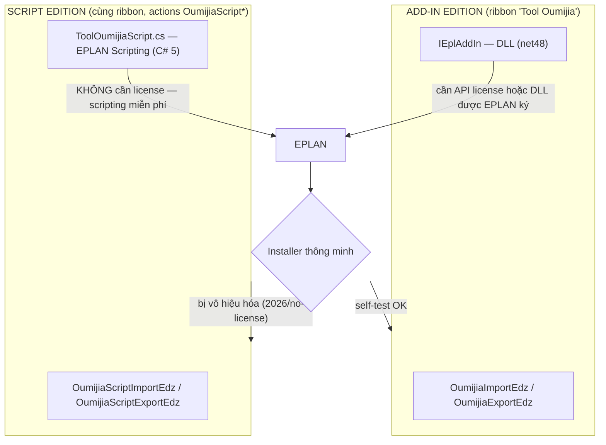

# Kế hoạch v0.5.0 — "Script Edition" (+ fix nhập/xuất)

> Trạng thái: **đang triển khai**. Tổng hợp:
> - Issue #1 (GitHub): trên EPLAN 2026.0.3 Education **không có API license**, DLL add-in chưa ký
>   bị EPLAN **vô hiệu hóa** — nhưng **EPLAN Scripting chạy không cần license** (đã kiểm chứng).
> - Fix lỗi nhập `S030060: Invalid scheme` (tham số `strFieldMappingScheme` đang truyền rỗng).
> - Fix đích xuất: "Một file EDZ" chỉ chọn thư mục + tên file tự động theo mã sản phẩm.

---

## 1. Mục tiêu

| # | Mục tiêu | Kết quả |
|---|---|---|
| M1 | Fix nhập EDZ | Tự dò field-mapping scheme (`PartsManagementGui.FieldMapping.LastUsed` → fallback `Standardvorgabe EPLAN` → retry từ thông báo lỗi) |
| M2 | Fix đích xuất | "Một file EDZ": chỉ chọn THƯ MỤC; tên tự động (1 part → mã sản phẩm; nhiều → `parts.edz`); xem trước; hỏi ghi đè; nhớ thư mục |
| M3 | **Script Edition** | Tích hợp `ToolOumijia.cs` (đã kiểm chứng trên EPLAN 2026.0.3) + áp dụng M1/M2; chạy **không cần API license** |
| M4 | Installer thông minh | `Install-Tool-Oumijia.bat`: thử add-in → self-test → nếu bị vô hiệu hóa → tự chuyển Script Edition |
| M5 | Đóng gói | Zip chứa `addin\` + `script\` + installer thông minh + README chọn bản |
| M6 | Kiểm thử tại chỗ | Test trên EPLAN 2022.0.3: csc C#5, đăng ký script, self-test, import smoke |

## 2. Sơ đồ chức năng (2 editions — cùng tính năng)



- Cả hai editions dùng chung: cây chọn part + panel chi tiết + xuất theo loại bản ghi +
  nhập EDZ (đơn giản) + log/CSV + fix scheme M1 + UX đích xuất M2.
- Script edition: ribbon tạo trong `OnMainStart` (+ `OnLoadWorkspace`/`OnResetRibbon` cho bản mới),
  tự nạp qua `RegisterScript`, gỡ bằng `UnregisterScript`.

## 3. Giao diện — thay đổi đích xuất (M2)

```
┌─ Cách xuất ──────────────────────────────────────────────────────────────┐
│ Phạm vi: (•) Part đã chọn trên cây   ( ) Theo loại bản ghi (như EPLAN)    │
│ Đích:  (•) Một file EDZ (vào thư mục): [C:\Users\OWG\Documents   ] [Chọn thư mục…] │
│          → sẽ tạo: SIE.6ES7193-4CC30-0AA0.edz  (theo mã sản phẩm)         │
│        ( ) Mỗi part một file:          [thư mục..................] [Chọn thư mục…] │
│          → mỗi part 1 file, tên = mã sản phẩm (trong thư mục trên)        │
└──────────────────────────────────────────────────────────────────────────┘
```
- File tồn tại → hỏi **Ghi đè?**; thư mục đích tự tạo nếu chưa có; nhớ 2 thư mục cho lần sau
  (`%APPDATA%\Tool Oumijia\export-folders.txt`).

## 4. Fix scheme nhập (M1) — cơ chế đã xác minh

```text
S030060 khi strFieldMappingScheme = "" (null)
Scheme EPLAN đang dùng: USER.PartsManagementGui.FieldMapping.LastUsed = "Standardvorgabe EPLAN"
Thứ tự thử: LastUsed (USER→STATION) → "Standardvorgabe EPLAN" → tên đọc từ chính thông báo lỗi
```

## 5. Script Edition — kỹ thuật (đã kiểm chứng trên EPLAN 2022.0.3 + file người dùng trên 2026.0.3)

| Điểm | Kết luận |
|---|---|
| `[DeclareRegister]`/`[DeclareUnregister]`/`[DeclareEventHandler]` | ✅ Có trên 2022.0.3 |
| `OnMainStart` | ✅ Có trên 2022 |
| `OnLoadWorkspace`, `OnResetRibbon` | ⚠️ Không thấy trên 2022 (bản mới) — giữ cho tương lai, vô hại khi vắng |
| Ngôn ngữ | **C# 5** — csc v4.0.30319 của máy compile sạch 0 lỗi |
| Actions | `OumijiaScriptImportEdz` / `OumijiaScriptExportEdz` / `OumijiaScriptSelfTest` (khác tên add-in → không xung đột) |
| ⭐ **Compiler script của EPLAN reference gì?** | Trên **2022.0.3**: `mscorlib`, `System`, `System.Core` (LINQ OK — đã test), `System.Drawing`, `System.Windows.Forms`, `System.XML`, `System.Xml.Linq`, `System.IO.Compression.FileSystem`, `Eplan.EplApi.{AFu, Baseu, Guiu, EServicesu, RecorderToolsu}` — **KHÔNG có `Eplan.EplApi.MasterDatau`** → script dùng MasterData **không compile được trên 2022**. Trên **2026.0.3** (máy người dùng đã kiểm chứng: đọc 552 part) → **có** MasterData. ⟹ Script Edition phục vụ EPLAN mới (nơi add-in bị chặn); EPLAN cũ dùng add-in (không cần license). |
| ⭐ **Đăng ký script tự nạp** | Action `RegisterScript` của EPLAN 2022 chạy "không lỗi" nhưng **KHÔNG ghi gì** (đã kiểm chứng — bẫy!). Cách hoạt động đã kiểm chứng: **tự ghi settings** `STATION.EplanEplApiScriptGui.Scripts` (danh sách indexed) bằng script chạy trong EPLAN — ghi + persist + đọc lại OK; gỡ = viết lại danh sách bỏ entry của mình. |
| ⭐ **Loader tự nạp** | EPLAN (kể cả 2022) **có tự thử nạp** các script trong danh sách khi khởi động — quan sát trong `EplLog.eldb`: lỗi compile S046006/S046007 của đúng file đã đăng ký xuất hiện ở các lần khởi động. Cơ chế chuẩn — chỉ khác reference theo phiên bản EPLAN. |
| ⭐ **Chẩn đoán** | Log lỗi script nằm trong **`C:\Users\Public\EPLAN\Electric P8\EplLog.eldb`** (mã S04600x + chi tiết CSxxxx từng dòng). Dùng khi debug script/bản script trên máy mới. |

## 6. Danh sách thay đổi repo

```
SỬA:
  src/Oumijia.EplanAddIn/Ui/ImportEdzForm.cs      dùng ImportPartsSupport
  src/Oumijia.EplanAddIn/Ui/ExportEdzForm.cs      đích xuất mới (M2)
  src/Oumijia.EplanAddIn/Actions/DiagPartsAction.cs  + import smoke test
  src/Oumijia.EplanAddIn/Oumijia.EplanAddIn.csproj   version 0.5.0
  tools/pack.ps1                                  zip 2 bản (addin\ + script\)
THÊM:
  src/Oumijia.EplanAddIn/Ui/ImportPartsSupport.cs    resolve scheme + retry
  tools/script-edition/ToolOumijiaScript.cs          script C#5 (từ file người dùng + M1/M2)
  tools/script-edition/Install-Script.ps1/.bat, Uninstall-Script.ps1/.bat, README.txt
  tools/install-all/Install-Tool-Oumijia.ps1/.bat, Uninstall-Tool-Oumijia.ps1/.bat, README.txt
  docs/PLAN-v0.5.0.md (tài liệu này), docs/releases/v0.5.0.md
CHỈNH DOCS: README, AGENTS (R17 license / R18 script), INSTALL, USER-GUIDE, ARCHITECTURE, ROADMAP, CHANGELOG
```

## 7. Kế hoạch kiểm thử

| # | Test | Cách chạy | Kỳ vọng |
|---|---|---|---|
| T1 | Build add-in | dotnet build | 0/0 |
| T2 | SelfTest add-in | headless | `OnInit 0.5.0.0` + SELFTEST OK |
| T3 | **Import scheme (add-in)** | DiagParts: export 1 part → import lại | `IMPORT SMOKE OK (scheme='Standardvorgabe EPLAN')` |
| T4 | Construct UI | DiagParts | OK cả 2 form |
| T5 | csc C#5 script | csc /target:library | 0 lỗi (tự bắt cú pháp > C#5) |
| T6 | Register script | `RegisterScript /ScriptFile:…` headless | Settings có script đăng ký |
| T7 | Script tự nạp + action | `/Auto … OumijiaScriptSelfTest` | `SELFTEST OK - script loaded` trong addin.log |
| T8 | Unregister script | `UnregisterScript` | Gỡ sạch, log OK |
| T9 | Pack | pack.ps1 -Version 0.5.0 | zip 2 bản + hashes |
| T10 | UAT | Người dùng trên EPLAN 2026.0.3 | Ribbon + nhập/xuất hoạt động |

## 8. Tiêu chí nghiệm thu

1. ✅ Nhập EDZ (cả 2 editions) chạy đúng, không còn `S030060`
2. ✅ "Một file EDZ": chỉ chọn thư mục; tên = mã sản phẩm (1 part) / `parts.edz`; có xem trước; hỏi ghi đè
3. ✅ Script Edition: compile C#5, tự nạp sau khi đăng ký, ribbon + actions chạy, log đầy đủ
4. ✅ `Install-Tool-Oumijia.bat`: tự chọn bản phù hợp (add-in OK → giữ; bị chặn → script)
5. ✅ Zip v0.5.0 chứa cả 2 bản + README; release notes + đóng issue #1

## 9. Kết quả kiểm thử thực tế (2026-11-04, EPLAN Platform 2022.0.3)

| # | Test | Kết quả |
|---|---|---|
| T1 | Build add-in 0.5.0 | ✅ 0 warning / 0 error |
| T2 | SelfTest add-in | ✅ `OnInit 0.5.0.0` + SELFTEST OK |
| T3 | **Import smoke (scheme fix)** | ✅ `IMPORT SMOKE OK: 1 part re-imported (scheme='Standardvorgabe EPLAN')` — hết lỗi S030060 |
| T4 | Construct UI offscreen | ✅ cả 2 form OK |
| T5 | csc C#5 cho ToolOumijiaScript.cs | ✅ 0 lỗi |
| T6 | Ghi registration script list | ✅ persist qua nhiều instance, đọc lại đúng |
| T7 | Loader tự nạp | ✅ quan sát `EplLog.eldb`: EPLAN tự thử compile script đã đăng ký khi khởi động (trên 2022 fail vì thiếu MasterData — đúng dự kiến) |
| T8 | Unregister + cleanup | ✅ |
| T9 | Pack 2 editions | ✅ `Tool-Oumijia-v0.5.0.zip` (20 file, ~100 KB) |
| T10 | UAT trên EPLAN 2026.0.3 | ⏳ người dùng (bản script đã được người dùng kiểm chứng trước đó: đọc 552 part, xuất EDZ OK) |
