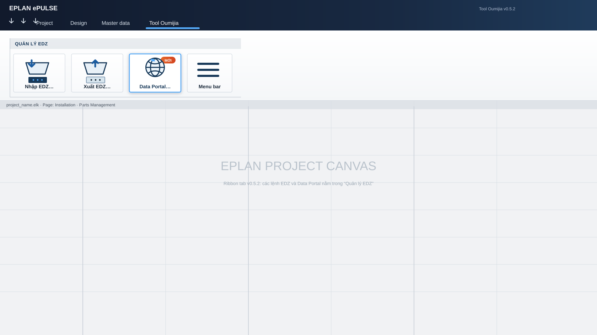
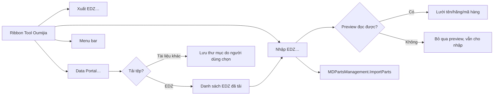

# Kế hoạch v0.5.2 — EPLAN Data Portal và nhập EDZ mới

> **Trạng thái:** triển khai theo yêu cầu người dùng ngày 2026-11-06.  
> **Nền:** `main` ở v0.5.1.  
> **Mục tiêu:** thêm EPLAN Data Portal chính thức và làm lại giao diện hộp Nhập EDZ theo cùng phong cách/bố cục với Xuất EDZ.  
> **Hai edition:** Add-in và Script Edition.



*Mockup ribbon dùng phong cách EPLAN/Industrial; các cửa sổ khác được mô tả trong tài liệu này.*

---

## 1. Quyết định đã chốt

1. Giữ giao diện v0.5.1, chỉ chuẩn hóa nhẹ; không redesign toàn bộ.
2. Ribbon **Tool Oumijia** có đúng 4 lệnh theo thứ tự:
   1. Nhập EDZ…
   2. Xuất EDZ…
   3. Data Portal…
   4. Menu bar
3. Phong cách **EPLAN/Industrial**: nền trắng/xám, navy/blue accent, chữ Segoe UI, log Consolas.
4. Hai edition dùng cùng layout và hành vi.
5. Hộp **Nhập EDZ** chuyển sang hai cột giống Xuất EDZ.
6. Phần chi tiết Nhập hiển thị:
   - Tên file, dung lượng, ngày sửa, trạng thái.
   - **Part bên trong `.edz`** với đúng 3 cột: `Tên thiết bị | Hãng | Mã hàng`.
   - File nhiều part chọn dòng trong lưới để xem.
7. File `.edz` lỗi không chặn nhập; bỏ qua preview, hiển thị trạng thái lỗi và nối tiếp các file khác.
8. Tải từ Data Portal của `.edz` có thể chuyển sang Nhập EDZ.
9. Tài liệu khác chỉ lưu về folder người dùng chọn, không tự sửa/import.
10. Master Data không bị sao chép hàng loạt; EDZ vào Parts Database qua API chính thức.
11. Không bypass license/captcha/điều khoản EPLAN; dùng tài khoản hợp lệ và portal chính thức.

---

## 2. Luồng tổng thể



---

## 3. Hệ thống hình ảnh chung

- Nền cửa sổ: trắng; vùng trạng thái/header: navy/slate hoặc blue nhạt.
- Nút chính: xanh EPLAN (`#1D5DA1` đến `#2877C8`), chữ trắng; nút phụ: nền xám nhạt, viền `#C8D0D9`.
- Focus: viền xanh rõ; trạng thái disabled: chữ xám, nút mất tương phản nhưng vẫn đọc được.
- Icon: outline kỹ thuật, kích thước 16/20/24 px; không dùng logo EPLAN giả; icon Portal dùng network/globe.
- `Segoe UI` cho UI; `Consolas` cho log.
- Lề chuẩn 10–14 px; khoảng cách 8 px; không có nút quan trọng ở mép ngoài cùng.
- DPI-aware: dock/TableLayoutPanel/FlowLayoutPanel; SplitContainer đặt kích thước trong `OnShown`.
- Mọi lệnh có tooltip; thao tác dài có progress/wait cursor và log.

---

## 4. Ribbon Tool Oumijia

```text
┌──────────────────────────────────────────────────────────┐
│ Tool Oumijia                                             │
├──────────────────────────────────────────────────────────┤
│ Quản lý EDZ                                              │
│ ┌───────────┐ ┌───────────┐ ┌───────────┐ ┌────────────┐ │
│ │ Nhập EDZ… │ │ Xuất EDZ… │ │Data Portal│ │ Menu bar   │ │
│ │ Import    │ │ Export    │ │ chính thức│ │ Toggle     │ │
│ └───────────┘ └───────────┘ └───────────┘ └────────────┘ │
└──────────────────────────────────────────────────────────┘
```

### Quy tắc

- `Data Portal…` đứng giữa `Xuất EDZ…` và `Menu bar`.
- Add-in và Script Edition tạo cùng thứ tự, cùng nhãn; không thêm lệnh cũ.
- `Menu bar` gọi `MfToggleMainMenuAction`; nếu EPLAN không cung cấp action, không báo thành công giả.
- Portal không làm hỏng ribbon hoặc các hành vi EDZ hiện có.

---

## 5. Nhập EDZ — giao diện mới

```text
┌─ Tool Oumijia — Nhập EDZ ───────────────────────────────────────┐
│ Database: ESS_part001.alk                                        │
│ [Thêm tệp…] [Thêm thư mục…] [Xóa mục chọn] [Xóa hết]             │
├───────────────────────────┬─────────────────────────────────────┤
│ Các gói EDZ cần nhập      │ Chi tiết gói EDZ                    │
│ ┌──────────────────────┐  │ File: motor.edz                      │
│ │ motor.edz            │  │ Size: 2.4 MB · Sửa: 06/11/2026      │
│ │ relay.edz            │  │ Trạng thái: Sẵn sàng                │
│ │ …                    │  ├─────────────────────────────────────┤
│ └──────────────────────┘  │ Part trong EDZ                       │
│                           │ ┌─────────────┬───────┬────────────┐ │
│                           │ │Tên thiết bị │Hãng   │Mã hàng     │ │
│                           │ ├─────────────┼───────┼────────────┤ │
│                           │ │Motor 3 pha  │SIE    │1LA7080…    │ │
│                           │ │Relay nhiệt  │OMR    │MY4…        │ │
│                           │ └─────────────┴───────┴────────────┘ │
│                           │ Chọn dòng để xem content chính        │
├───────────────────────────┴─────────────────────────────────────┤
│ Đã nạp: 3 | Đọc preview: 2 | Lỗi: 1             [NHẬP ▸]      │
│ 14:21:02 Đã thêm 2 gói EDZ …                                    │
└─────────────────────────────────────────────────────────────────┘
```

### Layout

- Cột trái rộng ~58%, cột phải ~42%; splitter di chuyển được.
- Trên cùng là database và hàng nút; `Thêm tệp…` là nút primary.
- Danh sách trái dùng `ListBox` mở rộng đầy đủ; chọn một hoặc nhiều file.
- Panel phải hiển thị thông tin file đã chọn:
  - Tên, đường dẫn, dung lượng, ngày sửa, số part.
  - Trạng thái: `Sẵn sàng`, `Không đọc được preview`, `File không tồn tại`, `EDZ quá lớn/không an toàn`.
- Lưới parts bên phải có đúng ba cột:
  - Tên thiết bị
  - Hãng
  - Mã hàng
- Lưới cho phép chọn dòng; chọn part không thay đổi thứ tự import, chỉ phục vụ xem trước.

### Hành vi đọc preview

- EDZ là container chính thức (thường 7z); reader chỉ đọc metadata `part.xml`, không giải nén toàn bộ package vào disk.
- Giới hạn parser:
  - tối đa 5 MB cho một `part.xml`;
  - timeout/cảnh báo với package quá lớn hoặc archive lỗi;
  - không tạo file trung gian không cần thiết.
- Với hồ sơ nhiều part, show tối đa 500 dòng preview; log “hiển thị 500/…” thay vì treo UI.
- Với EDZ hỏng/không có part XML:
  - vẫn cho vào danh sách nhập;
  - panel báo “Không đọc được preview EDZ”;
  - file có thể được chọn lại để xem bằng log lỗi.
- Không upload dữ liệu lên dịch vụ ngoài; đọc local bằng thư viện mã nguồn mở được đóng gói trong ứng dụng.

### Nút nhập

- Ở dòng thống kê cuối cùng, bên phải; chữ đậm như hướng dẫn Xuất.
- Disabled khi chưa có file.
- Đếm: đã nạp / preview thành công / lỗi.
- Khi nhập, nút bị vô hiệu; không đóng cửa sổ cho tới khi EPLAN trả về.
- Giữ logic `ImportParts` hiện tại: UpdateAndAppend, nhận dạng theo mã hàng; không thêm tùy chọn UI.

---

## 6. Xuất EDZ

Không đổi nghiệp vụ; đồng bộ phong cách:

```text
┌─ Tool Oumijia — Xuất EDZ ────────────────────────────────────────┐
│ Database: ESS_part001.alk — 647 part                              │
│ [Tìm…………] [Chọn tất cả] [Bỏ chọn] [Lấy từ Parts Management ▸]  │
├────────────────────────────┬──────────────────────────────────────┤
│ Cây part                   │ Chi tiết part                         │
│ (checkbox native)          │ Thuộc tính | Giá trị                 │
├────────────────────────────┴──────────────────────────────────────┤
│ Cách xuất … (tree selection / record types)                        │
│ Đích xuất … → sẽ tạo …                                           │
├───────────────────────────────────────────────────────────────────┤
│ Đã chọn: N part                                     [XUẤT RA ▸] │
└────────────────────────────────────────────────────────────────────┘
```

- Sửa chỉ các điểm visual/consistent: màu nút, font, label và DPI; không thay model hay API.
- Checkbox native giữ nguyên; cây và `AdoId` giữ nguyên; record-type export vẫn hiển thị warning file lớn.
- Nút Xuất nằm cùng dòng với đếm `Đã chọn…`; không để bị che.
- Empty state khi tìm không thấy part.
- Sửa các text lỗi/fallback để dùng cùng style với Nhập.

---

## 7. EPLAN Data Portal

```text
┌─ Tool Oumijia — EPLAN Data Portal ──────────────────────────────────┐
│ ←  →  ⟳   [https://dataportal.eplan.com                  ] [Mở ngoài] │
│ Tải: [C:\…\Documents\Tool Oumijia_Downloads] [Chọn…] [Mở thư mục]    │
│ Profile: …\Tool Oumijia\WebView2       [Xóa dữ liệu phiên]           │
│ ┌──────────────────────────────────────────────────────────────────┐ │
│ │             WebView2 — EPLAN Data Portal chính thức              │ │
│ │              Người dùng tự đăng nhập; Tool không lưu              │ │
│ └──────────────────────────────────────────────────────────────────┘ │
│ Đã tải: catalogue.pdf · EDZ mới: 1 file                            │
│ [Nhập EDZ vừa tải (1)] [Đóng]                                        │
└──────────────────────────────────────────────────────────────────────┘
```

### Giao diện

- Profile riêng trong `%APPDATA%\Tool Oumijia\WebView2`.
- Thanh điều hướng Back/Forward/Reload và address bar.
- Nút **Mở ngoài** luôn sẵn sàng; dùng browser mặc định.
- Hàng thư mục tải có chọn/remember; không mặc định đổi Master Data.
- Nút **Xóa dữ liệu phiên** yêu cầu xác nhận và xóa profile portal.
- Khu vực WebView2 chiếm toàn bộ vùng giữa; không che bằng nội dung giả.

### Tải file

- Người dùng chủ động tải trong portal.
- File trùng tên: `Ghi đè / Lưu với tên khác / Hủy`.
- EDZ tải xong được đưa vào danh sách phiên; nút **Nhập EDZ vừa tải (N)** chuyển sang hộp Nhập.
- Tài liệu khác được lưu về folder, không tự nhập hay sửa.
- Log CSV chỉ ghi timestamp, tên file, đường dẫn, status; URL loại query/fragment.
- Không tải hàng loạt/crawl; không giả lập thao tác người dùng.

### Lỗi/Fallback

- Không có Runtime, portal không load, Proxy/cert issue: hiển thị panel lỗi có nội dung cụ thể.
- Nút: **Thử lại**, **Mở ngoài**, **Cài/Update WebView2 Runtime** từ trang Microsoft chính thức.
- Không sửa hosts/SSL/proxy, không bypass license; liên hệ IT/EPLAN nếu endpoint bị chặn.
- Các chức năng EDZ cũ phải hoạt động độc lập với Portal.

---

## 8. Menu bar

- Nút gọi `MfToggleMainMenuAction`.
- Nếu action có trong phiên EPLAN, toggle menu chính.
- Nếu không có, hiển thị trạng thái “EPLAN không cung cấp lệnh Menu bar trong phiên này.” và ghi log.
- Không giả lập menu EPLAN.

---

## 9. Kiến trúc triển khai

```text
src/Oumijia.EplanAddIn/
  Actions/DataPortalAction.cs      (ordinal 25)
  Ui/ImportEdzForm.cs              (hai cột + preview)
  AddIn.cs                         (nút Portal)
src/Oumijia.EdzReader/              (net48/x64; đọc metadata local)
  EdzPackageReader.cs               (7z/zip + part.xml)
  PartXmlParser.cs                  (tên/hãng/mã)
src/Oumijia.PortalHost/            (net48/x64; dùng chung Portal UI)
  PortalForm.cs
  PortalPaths.cs
  PortalEnvironment.cs
tools/script-edition/              (cùng UI/actions, loader reflection)
tools/install-*                    (copy dependencies / Portal)
tools/pack.ps1                     (đóng gói v0.5.2)
```

- Add-in gọi trực tiếp assembly shared.
- Script Edition (`C# 5`) nạp `Oumijia.EdzReader.dll` và `Oumijia.PortalHost.dll` qua reflection; không yêu cầu EPLAN script compiler tham chiếu WebView2/SharpCompress.
- Packaging chứa các dependency đã chọn; không bundle WebView2 Runtime.
- `Oumijia.EdzReader` có thể dùng `SharpCompress` (giấy phép mã nguồn mở phù hợp); assembly phải được copy ở mọi bản cài, và hash được ghi trong release notes.

---

## 10. Thay đổi cần làm

### Add-in

1. Thêm reference/project cho EdzReader và PortalHost.
2. Thêm `DataPortalAction`, cập nhật ordinal và registration script (v0.5.2 dùng ordinal 25).
3. Thêm nút vào ribbon.
4. Mở rộng `ImportEdzForm`:
   - `IEnumerable<string> initialFiles`;
   - split two-pane;
   - file metadata;
   - lưới part preview;
   - button import style Export;
   - preview error handling.
5. Giữ `ExportEdzForm` logic, chỉ polish visual.

### Script Edition

1. Trích `Oumijia.EdzReader` với API đơn giản (`Read(path)`).
2. Nạp Reader/Portal qua reflection ở `%APPDATA%\Tool Oumijia\Portal\`.
3. Cùng ribbon buttons, C#5 compatibility.
4. Cùng UI layout, không copy source WebView2 vào script.

### Packaging/Docs

1. `pack.ps1 -Version 0.5.2`, output ZIP.
2. README/INSTALL/USER-GUIDE/BUILD/CHANGELOG/ROADMAP/AGENTS cập nhật.
3. PowerShell scripts giữ UTF-8 BOM.

---

## 11. Kiểm thử

| # | Test | Kỳ vọng |
|---|---|---|
| T1 | Build Add-in | 0 warning / 0 error |
| T2 | `csc /langversion:5` | 0 error |
| T3 | EDZ synthetic: 1 package/nhiều part | Lưới hiển thị đúng tên/hãng/mã |
| T4 | EDZ hỏng | Không crash, preview bỏ qua, file vẫn trong list |
| T5 | EDZ 7z lớn | Không treo UI; log giới hạn preview |
| T6 | Import từ danh sách | ImportParts nhận đúng file |
| T7 | Portal → nhập EDZ | Hộp Nhập mở với file vừa tải |
| T8 | WebView2 thiếu/portal lỗi | Fallback panel, không màn hình đen |
| T9 | Xóa profile | Cookie/cache portal bị xóa |
| T10 | v0.5.1 regression | Nhập/xuất EDZ và checkbox giữ nguyên |
| T11 | Pack | ZIP có đủ Add-in/Script/Portal/Reader/dependencies |
| T12 | UAT EPLAN 2022 | Add-in chạy; không bypass/license workaround |

---

## 12. Tiêu chí nghiệm thu

1. Ribbon có đúng 4 lệnh và đúng thứ tự.
2. Nhập EDZ hai cột, lưới part, file lỗi không crash.
3. Nút nhập đồng bộ Export, luôn thấy và disable đúng.
4. Data Portal người dùng tự đăng nhập, không lưu credential.
5. EDZ tải được chuyển sang Nhập.
6. Cả hai editions hoàn thành hoặc báo rõ lý do nếu EPLAN chặn.
7. Các feature v0.5.1 không hồi quy.
8. Test thực tế trên EPLAN 2022 trước khi tag/release.

---

## 13. Lộ trình

1. Viết lại tài liệu này (hoàn thành trước code).
2. Build shared EdzReader bằng file EDZ tổng hợp; test parser.
3. Làm Nhập EDZ UI + preview.
4. Làm PortalHost và action/ribbon.
5. Port Script Edition.
6. Pack/install/test/UAT.
7. Chỉ phát hành khi kiểm thử đạt.
